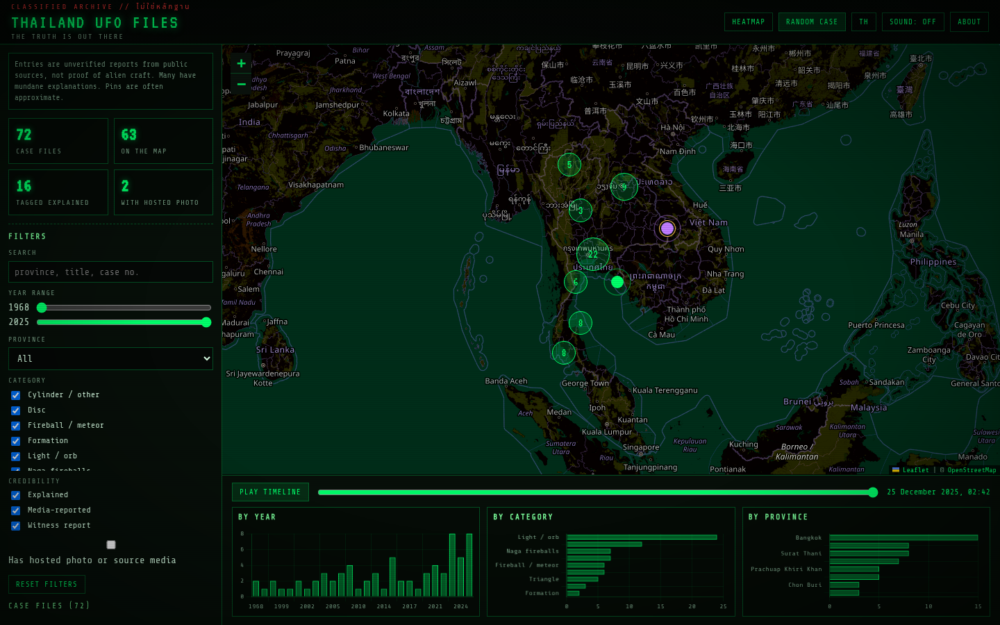
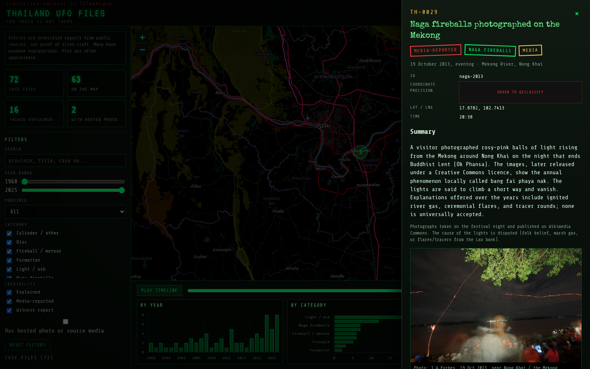
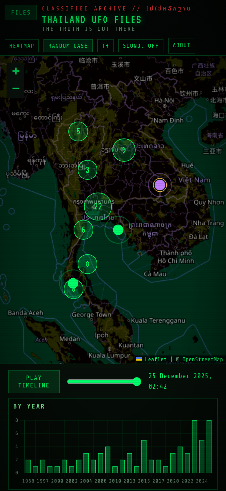
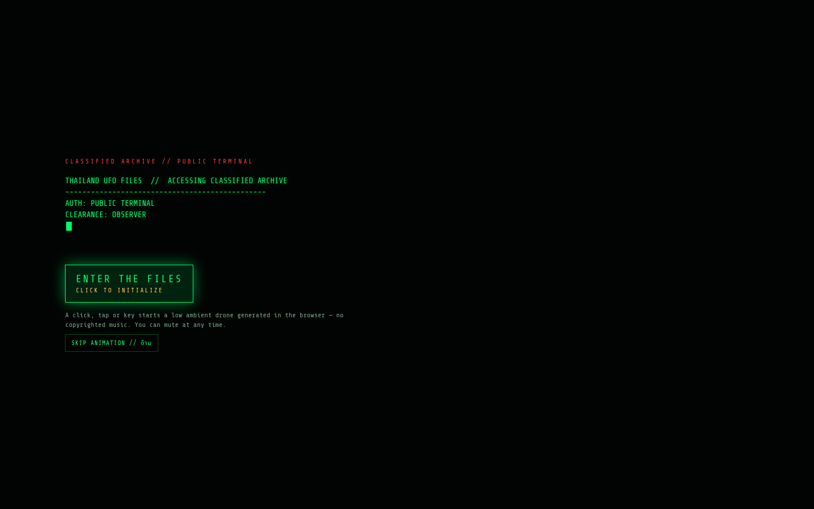
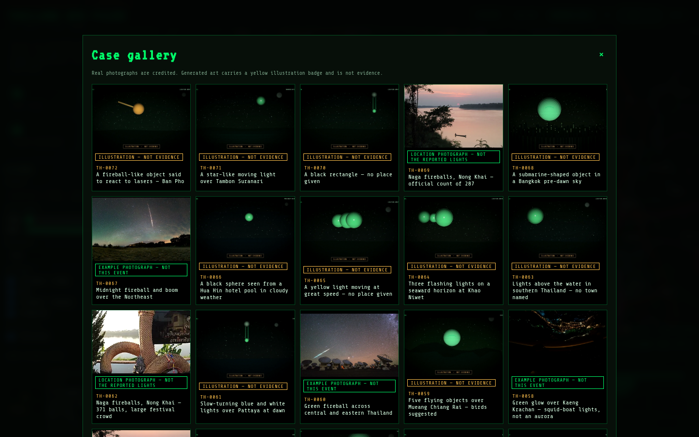
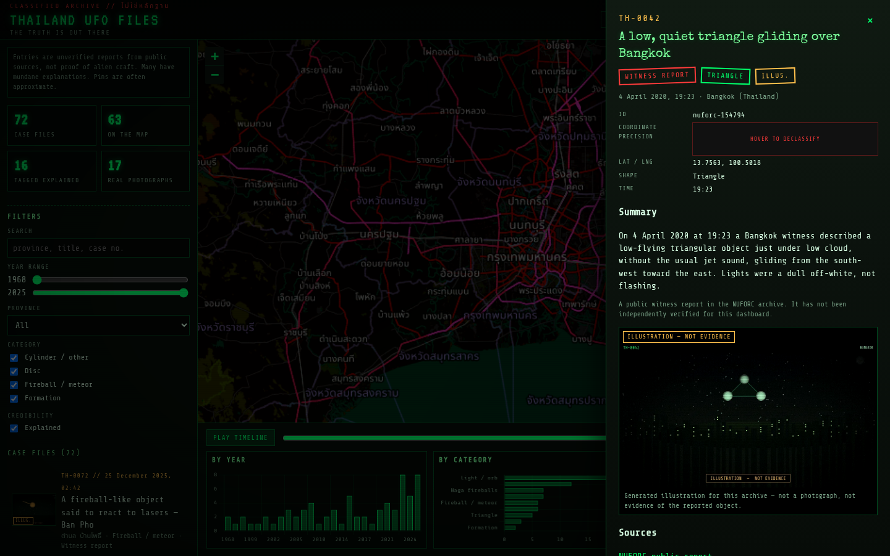

# Thailand UFO Files

An X-Files-inspired public dashboard of **reported** UFO, UAP and unusual-sky events in Thailand.

**Live site:** [https://piyaster11.github.io/thailand-ufo-files/](https://piyaster11.github.io/thailand-ufo-files/)

This is a classified-file aesthetic, not a claim of secret knowledge. Every entry is an unverified public report. Many have ordinary explanations (meteors, the ISS, Starlink trains, weather balloons, sky lanterns, clouds, rocket debris). Pins are geocoded from named places and are often approximate. Nothing in the dataset was invented; if a source was blocked, it was skipped.













## What’s on the dashboard

- Dark, phosphor-green map of Thailand (Leaflet + OpenStreetMap tiles with a green CRT filter) with pulsing markers, clustering, a radar-sweep overlay and an optional heatmap
- Case-file drawer for each report, with a short summary, source links, a “View source” button, a picture on every file, and a shareable `#case=` URL
- Filters for year, province, category and credibility, plus a search box
- A playable timeline, count-up statistics, and charts by year, category and province
- English / Thai labels
- A “Random case” button
- `prefers-reduced-motion` support (boot animation, marker pulse and count-up are eased or skipped)
- Optional UI beep, **off by default**

## The data, honestly

The archive mixes:

- **NUFORC** public Thailand filings, read from a Wayback Machine snapshot of the official index dated 13 May 2026 (the live nuforc.org site presented a Cloudflare challenge from the build environment). Individual links still point at nuforc.org.
- **News and science comments** from Bangkok Post, The Nation, Thai PBS, Thairath, Manager Online, BBC Thai, The Thaiger, Thai Channel 8, PPTV and Matichon, including identifications attributed to NARIT or the Thai Astronomical Society.
- **Naga fireballs (บั้งไฟพญานาค)** only for years with a post-event official or press count, or a contemporary photograph. Festival preview articles were not treated as confirmation. The cause of the Mekong lights is disputed.

Reddit’s public JSON endpoint was not usable (it returned an HTML interstitial). MUFON was not available as an open dump. Those sources were skipped rather than scraped around a wall.

Rebuild the JSON after editing sources:

```bash
python3 pipeline/build_sightings.py
```

Raw inputs live in `pipeline/nuforc_raw.json` and `pipeline/curated_events.json`.

## Photographs and illustrations

Every case file has a picture. That is not the same as a photograph of the event.

- The only hosted photographs of a specific Thai event are J A Forbes’s *Beung Fai Phraya Nag* series, 19 October 2013, [CC BY-SA 4.0](https://creativecommons.org/licenses/by-sa/4.0/).
- A few other Wikimedia Commons stills are used as clearly captioned **examples** (a Starlink train, Yi Peng lanterns, the ISS, a weather balloon, Gulf of Thailand fishing lights, meteor fireballs taken outside Thailand) or as **Mekong location** photographs for later Naga fireball years. Credits and licences are on each case file. These must not be treated as pictures of that Thai night.
- All other cases use a generated X-Files-style illustration in `docs/img/illustrations/cases/`, stamped **ILLUSTRATION — NOT EVIDENCE**, with the case number and province overlaid.
- News photographs are **not** copied. Those cases keep a “View source” link.
- The media filter and gallery distinguish real photographs from illustrations. Thumbnails appear in the case list, map popups and the gallery.
- Hero and social images in `docs/img/illustrations/` are also generated artwork.

## Sound

Browsers block audio until a user gesture, so the site opens on an **ENTER THE FILES / CLICK TO INITIALIZE** splash. After that click, a low ambient drone (synthesized with the Web Audio API — no copyrighted X-Files music) starts with sound **on** by default. A mute toggle is always visible and is saved in `localStorage`. Audio is silenced when the tab is hidden. The typewriter boot is skippable and is skipped automatically under `prefers-reduced-motion`.

## Run it locally

```bash
# from the repository root
python3 -m http.server 8765 --directory docs
# then open http://127.0.0.1:8765/
```

## Fork and host your own copy on GitHub Pages

1. Fork or clone this repository (do not push over someone else’s existing dashboard).
2. In the new repo: **Settings → Pages → Deploy from a branch**, branch `main`, folder `/docs`.
3. After a few minutes the site will be at `https://<your-username>.github.io/thailand-ufo-files/`.

GitHub Actions is intentionally not required. The site is already a static folder.

## Licence

Code is under the MIT Licence. Witness reports remain the witnesses’ and NUFORC’s; news text remains with its publishers. Fonts are Share Tech Mono and VT323 (SIL Open Font Licence) and Special Elite (Apache License 2.0). Map tiles © OpenStreetMap contributors (rendered with a local green CRT colour filter).
